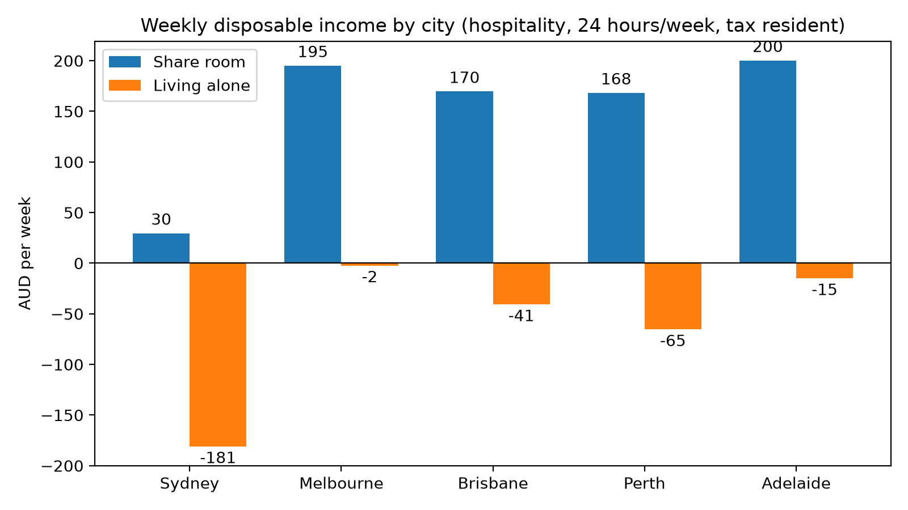

# Australia Student Disposable Income Explorer

Estimates how much money an international student has left each week after essential costs, across five Australian cities, two employment sectors and two living arrangements.

## Key findings

Base case: 24 hours a week at Level 1 casual award rates, tax resident, share house unless stated.

- **Living arrangement matters most.** Living alone is negative in all five cities in the hospitality sector. Retail is positive in Adelaide, Melbourne and Brisbane (A$19 to A$57 per week).
- **Adelaide ranks highest and Sydney lowest** in every one-at-a-time scenario tested. Sydney earns A$30 per week after costs in hospitality, against A$200 in Adelaide.
- **Tax residency status moves disposable income more than rent.** Moving from resident to foreign resident tax treatment reduces it by about A$188 per week, compared with A$33 to A$54 for a 10% rent rise.
- **Hours needed to break even** for living alone are 25 to 32 per week, above the 24 hours assumed in the base case.



## Method

1. **Collect:** 14 official and public sources, logged in `data/collection/source_register.csv` with URL, download date, reference period and limitations.
2. **Clean:** pandas checks for data types, missing values, duplicates and city-name consistency. Each fix is documented in `notebooks/01_load_and_check.ipynb`.
3. **Model:** weekly net income after tax and the low income tax offset, minus rent, transport, OSHC, food, utilities and phone (`notebooks/02_model.ipynb`).
4. **Scenarios:** rent, working hours, tax residency, food and transport (`notebooks/03_scenarios.ipynb`).
5. **SQL:** the same model rebuilt with DuckDB, validated against Python to within two cents (`sql/disposable_income.sql`, `notebooks/04_sql.ipynb`).

## Assumptions

- Wages: Fair Work award minimum rates, Level 1, adult casual, 24 hours per week split as 12 weekday, 6 Saturday, 6 Sunday.
- Tax: ATO resident rates for 2026-27 and foreign resident rates for 2025-26 (assumed unchanged), with LITO for residents. Medicare levy excluded, assuming OSHC exemption.
- Rent: Flatmates average room rent for share house; SQM "All units" as a proxy for living alone.
- Transport: concession fares where eligible (Perth and Adelaide), full fare otherwise. Melbourne uses the half-price myki promotion to 1 January 2027.
- Food: Study Australia Cost of Living Calculator, moderate at-home spending. Adelaide's $189 is an outlier in the source; a $119 sensitivity case is included.
- OSHC: average of five providers.

## Limitations

- All results are estimates based on minimum wages and published averages, not actual student earnings.
- Hospitality and retail were chosen because they have award-based wage data. Tutoring and Junior IT were excluded because no comparable, defensible hourly wage data exists for casual student roles.
- Rent data are asking rents from different sources and dates, and the living-alone proxy includes all unit sizes.
- The study uses 24 hours per week as the base case. The hypothetical 48-hour scenario is a sensitivity test only, not a permitted work pattern.
- Student visa work limits and tax residency depend on individual circumstances and should be verified before use.

## Repository structure

```
data/
├── raw/          source files (PDFs, screenshots) by topic
├── collection/   tables compiled from raw sources (CSV)
└── clean/        cleaned tables and model output
notebooks/        01 load and check, 02 model, 03 scenarios, 04 SQL
sql/              disposable_income.sql
report/figures/   charts
```

## How to run

1. Install Python 3.12 or later, then `pip install pandas matplotlib duckdb openpyxl`.
2. Open the notebooks in order: `01_load_and_check`, `02_model`, `03_scenarios`, `04_sql`.
3. Run each notebook from top to bottom. Paths are relative to the `notebooks/` folder.

## Status

- [x] Data collection and documentation
- [x] Cleaning and quality checks
- [x] Disposable income model
- [x] Scenario analysis
- [x] SQL integration
- [ ] Power BI dashboard (in progress)
- [ ] Written report and recommendations

## Author

Katie Kieu. Business Analytics student, Deakin University.
